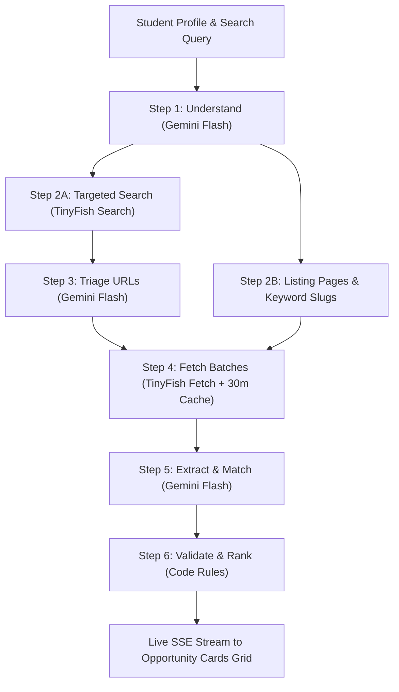

# 📡 Opportunity Radar

> Live opportunities from **20 trusted Indian and global portals**, intelligently matched to your student profile using live web data.

**Opportunity Radar** solves the fragmented search experience for Indian college students. Instead of checking 20 separate websites every week for upcoming deadlines, Opportunity Radar uses live web retrieval via the **TinyFish Search & Fetch APIs** and **Google Gemini Flash** to continuously monitor portals, extract verified active listings, filter out expired posts, and match them directly with a student's skills, year of study, and location preferences.

---

## ⚡ Key Highlights

- **Live Web Data, No Static Databases**: Queries live search indices and fetches live Chromium-rendered pages on demand.
- **20 Verified Portals Monitored**: Covers Internships (Internshala, AICTE, PM Internship Scheme), Hackathons (Devfolio, MLH, Hack2skill, DoraHacks, etc.), Competitions (Unstop, Kaggle, MyGov), Scholarships (Buddy4Study, NSP, DAAD), Fellowships (IASc Summer Research, Teach For India), and Open Source (GSoC, GSSoC, Outreachy).
- **Strict Verification (No Hallucinated Deadlines)**: Only real dates and active statuses with direct quote evidence from the page text are accepted. Expired listings are completely filtered out in code.
- **Real-Time Streaming**: End-to-end Server-Sent Events (SSE) update the UI as each stage of the radar pipeline completes.
- **Privacy & Security**: All API calls occur strictly in server-side API routes. API keys are never exposed to the client browser.
- **Fast and Resilient**: Built with in-memory 30-minute caching, a concurrency limiter (max 4 parallel calls), and automatic 429 retry handling.

---

## 🚀 Setup in 4 Steps

### Step 1: Install Dependencies
```bash
npm install
```

### Step 2: Configure API Keys in `.env.local`
Copy `.env.example` to `.env.local`:
```bash
cp .env.example .env.local
```
Or edit `.env.local` with your credentials:
```env
# TinyFish API key for live web search and Chromium-based fetching
TINYFISH_API_KEY=your_tinyfish_api_key_here

# Google Gemini API key for intelligence, triaging, and matching
GEMINI_API_KEY=your_gemini_api_key_here

# Default Gemini Flash model (fast & cost-effective)
GEMINI_MODEL=gemini-2.5-flash
```

### Step 3: Test Trusted Sources
Run the automated test script to fetch all 20 source portals using the TinyFish Fetch API and verify page readability:
```bash
npm run test:sources
```
This prints a structured status table showing character counts and preview snippets for all 20 sources.

### Step 4: Start the Development Server
```bash
npm run dev
```
Open [http://localhost:3000](http://localhost:3000) in your browser.

---

## 🛠 Architecture & Pipeline



1. **Understand (Gemini Flash)**: Analyzes student background, year, location preference, and synthesizes 5 targeted search queries.
2. **Gather**: Concurrently fires geo-targeted TinyFish searches (`location="IN"`, `after_date=60 days ago`) restricted to trusted domains, alongside an open-web query filtering spam/social media.
3. **Triage**: Gemini triages collected search results to discard listicles, news recaps, and past archives, picking the top 8 specific opportunity links.
4. **Fetch**: Fetches up to 10 URLs per batch using `https://api.fetch.tinyfish.ai`. Responses are cached for 30 minutes in memory.
5. **Extract & Match**: Evaluates page text (up to 20,000 characters) to identify open programs, required skills, stipends, and deadlines.
6. **Validate & Rank**: Drops expired items (`deadline_iso < today`), removes duplicates, and ranks by `fit_score` (1-10) and nearest deadline.

---

## ⚙️ How to Add or Remove Sources

All trusted sources are centralized in [`config/sources.ts`](./config/sources.ts).

To add a new portal, append an entry to the `TRUSTED_SOURCES` array:
```typescript
{
  name: "New Portal Name",
  url: "https://example.com/opportunities",
  domain: "example.com",
  category: "Hackathons", // "Internships" | "Hackathons" | "Competitions" | "Scholarships" | "Fellowships" | "Open Source"
  jsHeavy: false,
}
```

To remove a portal, simply delete its entry from the list or comment it out.

---

## 💡 Note on `jsHeavy` Single-Page Applications

Sources flagged with `jsHeavy: true` (such as Unstop, Buddy4Study, Hack2skill, Kaggle, DoraHacks) are dynamic JavaScript Single Page Applications (SPAs). While TinyFish Fetch renders pages through headless Chromium, heavy client-side hydration or aggressive anti-bot scripts may occasionally return thinner HTML snapshots.

These sources are prime candidates for the **TinyFish Agent API** in a future release to execute interactive browser workflows (e.g. clicking "Load More", selecting filters, or paginating).

---

## 🛡 Friendly Error Handling

The application maps server and external API codes into clear, actionable notifications:
- **401**: *"Your API key looks wrong. Please check your TINYFISH_API_KEY and GEMINI_API_KEY."*
- **429**: *"Too many requests, wait a minute."* (Automatically retries once after 3 seconds)
- **402**: *"Daily free limit reached."*
- **Network / Offline**: *"Couldn't reach TinyFish. Please check your network connection."*

---

## 📄 License

MIT. Built with Next.js, Tailwind CSS, Google Gemini, and TinyFish.
